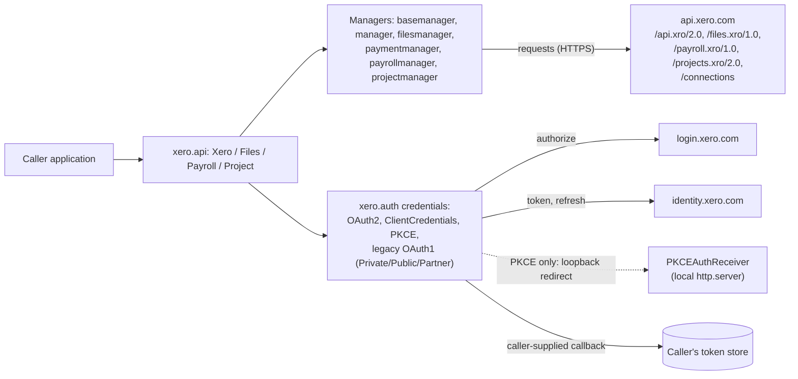

# pyxero architecture

pyxero is a Python client library for the Xero accounting API. It is not a
deployed service: it is imported into a caller's process and makes outbound
HTTPS calls to Xero. This fork carries no changes of its own (see
`.tracking.md`); the document describes upstream's structure.

## Diagram

## Services

None hosted. The package `src/xero` exposes four facades in `api.py`:
`Xero` (Accounting), `Files`, `Payroll` and `Project`. Each builds one manager
per endpoint on attribute access. `basemanager.py` holds the request, parsing,
filter and error-mapping logic; `exceptions.py` maps HTTP statuses to
exceptions; `utils.py` has helpers; `constants.py` has the URLs.

## Routes

pyxero serves no routes. The only listener is `PKCEAuthReceiver` in
`auth.py`, a short-lived `http.server` on loopback used to receive the OAuth2
PKCE redirect, started by `OAuth2PKCECredentials` when the caller asks for it.
Outbound Xero paths are listed in the diagram.

## Data stores

None. Credentials are held in memory. Persisting tokens is the caller's job;
`OAuth2Credentials` accepts a `callback` invoked when tokens refresh.

## Queues

None. Calls are synchronous; rate limits (HTTP 429/503 with `oauth_problem`)
raise `XeroRateLimitExceeded` and the caller decides on retry.

## External dependencies

- Runtime: `requests`, `requests-oauthlib`, `PyJWT`, `python-dateutil`
  (see `pyproject.toml`).
- Services: Xero APIs (`api.xero.com`), Xero login (`login.xero.com`) and
  identity (`identity.xero.com`).
- Dev: pytest, tox and pre-commit (see `tox.ini`).

## Deploy targets and machines

No deploy target or machine runs this code. It is released as a Python
package by upstream (freakboy3742/pyxero) on PyPI. This fork only pushes fix
branches that are submitted upstream as pull requests. Local checks run via
`tox` on any developer machine.
